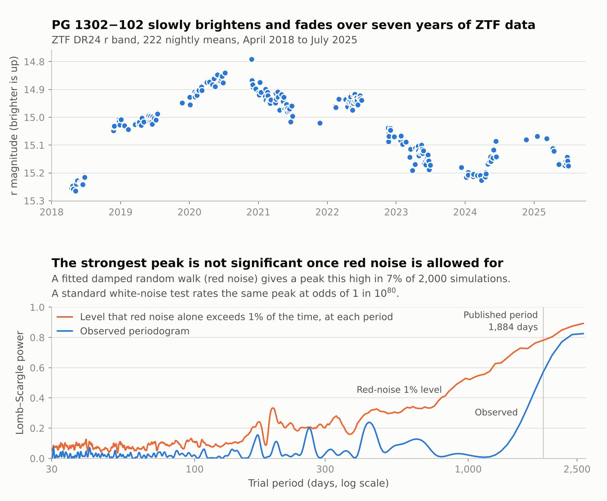

# Stargazer

Stargazer is a planned open-source tool that connects to public astronomical archives and searches them for
signals that natural processes do not easily explain: periodic "pulsing" (including in quasars), pulse trains,
narrowband radio tones, coded modulation and outliers. Every candidate is put through a fixed set of checks before
anyone calls it interesting, and anything that survives goes to a decoding workbench that recovers structure and
says plainly how much of it can be read.

**Status: research phase.** Nothing is built yet apart from a small feasibility check. This repository holds the
research, the project plan and the list of tools that would have to be invented.

## What is here

| Path | What it is |
|---|---|
| [`docs/PLAN.md`](docs/PLAN.md) | The project plan: requirements, an honest assessment of what is possible, architecture, the search and decoding pipeline, the phased roadmap, risks and open questions |
| [`docs/INNOVATION_AGENDA.md`](docs/INNOVATION_AGENDA.md) | The custom tools for analysing and translating unknown data that do not exist yet, with success metrics |
| [`docs/research/`](docs/research/) | The consolidated research report and eight per-topic notes with sources |
| [`spikes/first-light/`](spikes/first-light/) | The feasibility check: which archives are reachable, one real quasar light curve fetched, and a red-noise test run on it |

## The short version

- No sign of extraterrestrial technology has ever been confirmed, and no periodic quasar found in an optical
  survey has held up. The plan is built around that record.
- The data are public and reachable. One quasar's seven-year light curve was pulled from a public cloud copy in
  about eight seconds.
- The same light curve shows why care is needed. A textbook test rates its strongest "pulse" at odds of one in
  10⁸⁰; tested against the random wandering every quasar shows, the same peak arises by chance about 7% of the time.
- Stargazer reports where a signal stands on two ladders: how much scrutiny its existence and origin have survived,
  and how much of its content has been recovered. It never reports "a message".
- Realistic results, in order of likelihood: known phenomena rediscovered blind, published claims re-tested on
  newer data, calibrated upper limits, a short list of unexplained cases, and decoding tools proven on benchmark
  messages.

<picture>
  <source media="(prefers-color-scheme: dark)" srcset="docs/figures/first-light-pg1302-dark.png">
  
</picture>

## Data credit

The feasibility check uses the ZTF DR24 light-curve catalogue served by IRSA
(doi:[10.26131/IRSA598](https://www.ipac.caltech.edu/doi/10.26131/IRSA598)).
