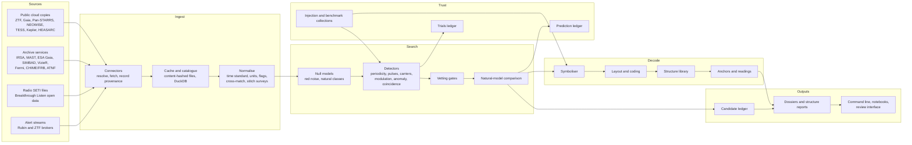
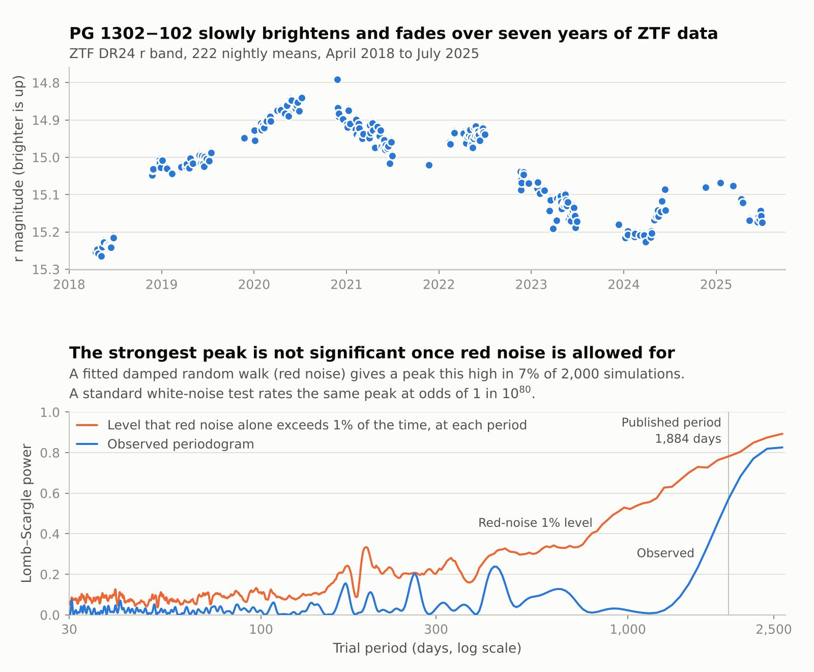

# Stargazer project plan

**Status:** draft v0.1, 2026-11-21. This is the research-phase draft. Nothing described here is built yet, apart from
the small feasibility scripts in `spikes/first-light/`.
**Research basis:** `docs/research/reports/Celestial signal search data and methods.md` (consolidated report) and the
per-topic notes in `docs/research/research_notes/Celestial signal search data and methods/`. Claims below that depend
on a paper, dataset or archive are traceable to those notes, which carry the source links and say how each fact was
checked.
**Companions:** `docs/INNOVATION_AGENDA.md` lists the custom tools this plan needs that do not exist yet.
A private sister project by the same owner supplies sequence-structure, decipherment and benchmark tools that
Stargazer adapts. It is referred to here as "the sister project" and described by function only; its code-level
reuse map is kept with that project, not in this repository.

---

## 0. How to read this document

Section 1 restates the brief as requirements. Section 2 is the honest capability assessment: it defines what
"a pattern of communication" and "translate" will mean inside Stargazer, because the science does not support the
everyday meaning of those words and the design must not pretend otherwise. Section 3 lists the research findings that
shape the design. Sections 4 to 9 are the design: principles, architecture, data model, search and analysis pipeline,
outputs, and the evaluation and disclosure framework. Section 10 is the phased roadmap with acceptance criteria.
Sections 11 to 13 list risks, assumptions and open questions for the project owner. The appendices give the proposed
repository layout, the data sources with what the development environment can reach, what is reused from the
sister project, the feasibility check already run on real data, a glossary, and the backlog of facts still to
verify.

Three terms recur. A **null model** is a statistical description of what a source does when nothing unusual is
happening; every significance in this plan is measured against one. **Red noise** is random variability that is
correlated in time, so that slow wanderings are larger than fast ones; quasars show it, and it imitates periodicity.
A **technosignature** is any measurable sign of technology, as distinct from a sign of life.

---

## 1. Goals and requirements

The brief, restated as requirements, with the component that satisfies each one and the phase that delivers it.

| # | Requirement (from the brief) | How Stargazer satisfies it | Phase |
|---|---|---|---|
| R1 | Connect to available celestial data sources | A source registry and a connector layer over public archives. Public cloud copies come first (Parquet catalogues in open buckets, queried in place), archive APIs second. A built-in check reports which sources the current machine can reach | 0 |
| R2 | Find patterns of communication or encoded data | A suite of detectors (periodicity, pulse trains, narrowband radio carriers, modulation and coding features, anomalies, coincidences between sources), each shipped with a null model fitted to the data's own sampling and noise, followed by structure analysis on signals reduced to symbols | 1–4, 6 |
| R3 | From other worlds or other sources | No origin is assumed. Every candidate is tested against instrumental, human-made, known-natural and unknown-natural explanations before it can be called unexplained. Human-made signals from space (Voyager 1, satellites) serve as positive controls | 1–4 |
| R4 | Include quasars pulsing | A quasar and active-galaxy module: periodic and quasi-periodic variability tested against red noise, light curves stitched across surveys, published periodic candidates re-tested on newer data, recurring X-ray eruptions, and predictions committed before new data arrive | 1 |
| R5 | Develop novel custom tools for translating unknown data and analysing it | The decoding workbench: signal to symbols, symbols to layout and coding, structure without meaning, anchors to shared knowledge, tiered readings, and a statement of what a real translation would need. The tools that do not exist yet are specified in `docs/INNOVATION_AGENDA.md` | 2, 5 |
| R6 | Use, adapt, refine and improve tools from the owner's earlier (private) project | Its structure library, decipherment pipeline, synthetic and cipher benchmarks, prediction ledger, evidence tiers and evidence-constrained text rendering are carried over and upgraded for astronomical inputs (Appendix C) | 2, 5 |
| R7 | Research phase only, for now | This plan, the innovation agenda, the research report and its notes. No implementation beyond the feasibility scripts | now |

Non-goals for the first release: controlling telescopes or scheduling observations, transmitting anything, processing
raw radio voltages at scale, and any public claim that a signal is artificial.

---

## 2. Honest capability assessment

### 2.1 What the science supports (November 2026)

- **Public data at scale, reachable without accounts.** The Zwicky Transient Facility's 24th data release holds
  more than five billion light curves (8.4 TB) in a public cloud bucket, and one quasar's seven-year light curve can
  be pulled from it in about eight seconds (Appendix D). Pan-STARRS single-epoch detections (72 billion rows), the
  Gaia DR3 source catalogue (1.8 billion rows, with quasar-candidate flags), NEOWISE single exposures, Kepler, K2
  and TESS light curves and the HEASARC high-energy archive are available the same way. These were listed and
  read directly from the development environment.
- **Mature methods exist for each signal type in the brief:** narrowband drift searches in radio spectrograms, pulse
  and periodicity searches, Gaussian-process models of red noise, and unsupervised anomaly detection, all with
  maintained open-source implementations.
- **Real pulsing phenomena exist in and around quasars.** Thirteen galactic nuclei show quasi-periodic X-ray
  eruptions repeating every few hours to days; a handful show X-ray quasi-periodic oscillations; ASASSN-14ko flares
  every 114 days; and two blazars have multi-year periodicities that have held up, PKS 2131−021 (phase-coherent
  across 47.9 years of radio data) and PG 1553+113 (about 2.2 years in gamma rays). All have natural explanations:
  orbits, precession and disc instabilities.
- **Compact objects pulse in catalogued, public ways.** The ATNF catalogue lists 4,393 pulsars. The second CHIME
  catalogue lists 4,539 fast radio bursts from 3,641 sources, 83 of them repeaters; one repeater is active on a
  16.35-day cycle. About a dozen long-period radio transients (periods from 7 minutes to 6.5 hours) have been found
  since 2022, and how they emit is not yet understood.
- **Structure can be measured without knowing meaning.** Entropy by context length, mutual-information decay,
  compression gain, segmentation and grammar induction are well-defined statistics, and the sister project already has a
  tested first implementation of them.
- **Messages designed to be decoded can be decoded.** The Arecibo message and the 2023 "A Sign in Space" exercise
  show that a cooperative sender's format can be recovered by people who were not told it.

### 2.2 What the science does not support

- **No technosignature has ever been confirmed.** More than sixty years of searches have ended with every candidate
  explained or unrepeatable. SETI@home's final analysis reduced about 12 billion detections to a few hundred
  candidates, 80 of which were re-observed; the "BLC1" signal seen toward Proxima Centauri in 2019 turned out to
  be interference. In this field the vetting is the product.
- **No periodic quasar from an optical survey has been confirmed.** When 116 periodic candidates found in Gaia data
  were checked against later ZTF data, the periodic model failed to predict what happened next in all 116; the
  authors conclude that strictly periodic quasars are at most a few per million (El-Badry, Hogg and Rix 2025). Earlier
  candidate lists from other surveys shrank the same way as baselines grew. Red noise is the cause: Appendix D shows
  an ordinary quasar scoring odds of one in 10⁸⁰ on a textbook test and one in fifteen on a correct one.
- **Nobody has proposed, let alone observed, an artificially modulated quasar.** The only quasar ever announced as
  a beacon was CTA-102, in 1965, on the strength of its variability. The claim was soon dropped: varying is what
  quasars do. A quasar's power output is around 10³⁹ watts;
  the published technosignature literature treats active galaxies as contaminants or as hypothetical power sources.
- **Survey light curves cannot carry a fast message.** Ground-based surveys sample a source every two or three
  nights with seasonal gaps, so only modulation slower than about a week can be tested, at a few hundred to a
  thousand samples per object per decade. Fast structure is testable only in the few thousand sources with
  space-based or X-ray timing.
- **"Not random" does not mean artificial.** Pulsar nulling fails randomness tests and repeating fast radio bursts
  show memory between bursts. Natural processes produce structured sequences.
- **An efficiently coded message looks like noise.** A sender who compresses or encrypts well leaves no statistical
  structure to find (Lachmann, Newman and Moore 2004). Only signals that are deliberately conspicuous, carelessly
  redundant, or carried on a tell-tale carrier are detectable at all.
- **There is no translation without common ground.** No communication system has ever been translated without a
  bilingual text, a related known language, or a shared world to point at, and no non-human communication has been
  translated. Large language models will produce a fluent "translation" of anything, which is a hazard here.

### 2.3 What "a pattern of communication" will mean in Stargazer

Stargazer never reports "a message" or "aliens". It reports where a signal stands on two independent ladders. The
first says how much scrutiny its existence and origin have survived. The second says how much of its content has been
recovered. A pulsar sits low on the first ladder (explained) and can still be analysed on the second; a clean
unexplained radio tone could sit high on the first with nothing on the second.

**Reality ladder: has it survived?**

| Tier | Name | Meaning | What moves a signal up |
|---|---|---|---|
| R0 | Hit | A statistic crossed its threshold in one dataset | A detector with a calibrated null model |
| R1 | Vetted | It is not an artefact of the instrument, the reduction or the sampling | The vetting gates of Section 7.6 |
| R2 | Confirmed | It recurs in independent data: another instrument, another band, or later observations that a committed prediction got right | Independent data, or the prediction ledger |
| R3 | Celestial | It is tied to a position on the sky and moves with the sky, not with the Earth, a satellite or the telescope | Localisation and sky-motion tests |
| R4 | Unexplained | The natural models tried do not account for it, and the list of models tried is published with it | Natural-model comparison |

A signal that fails a rung is not discarded. It receives a disposition (artefact, human-made, known natural class,
candidate new natural phenomenon) and stays in the ledger, because the rate at which each detector produces each
disposition is itself a measured result.

**Content ladder: what has been recovered?**

| Tier | Name | Meaning | Example of an honest statement |
|---|---|---|---|
| C0 | None | Content not analysed, or nothing found | "No content analysis was possible at this sampling" |
| C1 | Symbols | Discrete states or units recovered, stable across methods | "The pulse amplitudes fall into four levels (stability 0.93)" |
| C2 | Structure | Sequence structure beyond what the fitted natural model produces | "Entropy falls by 1.1 bits per symbol with two symbols of context; natural-model simulations give 0.1 or less" |
| C3 | Layout | Framing, dimensions or coding recovered, with compression gain and held-out prediction | "The stream folds into rows of 73 with a 2.4× compression gain that holds on the unseen half" |
| C4 | Anchored | Part of the content matches shared knowledge, at a significance corrected for everything tried | "The first eleven groups are the primes to 31 (corrected p = 10⁻⁶)" |
| C5 | Hypothesised meaning | A proposed reading, labelled as a hypothesis | "Consistent with the hypothesis that block 3 depicts a hydrogen atom" |

The content ladder extends the sister project's five evidence tiers (detected, typed, structured, context-associated,
hypothesised meaning) and keeps their rule: the wording of every output is fixed by its tier, and nothing above the
tier reached may be stated.

### 2.4 What "translate" will mean

Stargazer produces a **reading**, not a translation. A reading is a structured object: the symbols found, the layout
and coding, the structure statistics with their null models, any anchored content, and at most a hypothesised meaning,
each with its tier and its evidence. Every reading comes with a **translatability statement**, carried over from
the sister project: which requirements for a real translation are present (enough data, redundancy, anchors to shared
knowledge, validation on unseen data, a way to ask the sender), which are missing, and which single missing item
would help most. For a short, unanchored sequence the statement says that the material cannot support a translation,
and Stargazer shows structure only.

### 2.5 What success looks like

Given 2.2, the realistic outputs, in order of likelihood, are:

1. **Known phenomena rediscovered blind.** Pulsars, the periodic repeater, eclipsing binaries, Boyajian's Star and
   Voyager 1's carrier are found by the pipeline without being told where to look. This is how the detectors earn
   trust.
2. **Published claims re-tested.** Periodic-quasar candidates and similar claims are checked against newer data,
   with predictions committed before the data are seen.
3. **Calibrated upper limits.** "No periodic modulation above 0.1 magnitude at periods of 0.3 to 4 years in 100,000
   quasars, at 40% completeness" is a result, and a null search that states how much of the haystack it covered is
   worth publishing.
4. **A short ledger of unexplained cases** that survived every gate, each with a reproducible dossier. Most will
   become new natural astrophysics.
5. **Decoding tools that provably work on benchmark messages and provably abstain on natural and noise controls**,
   ready for the day they are needed, and useful immediately on the sister project's data.

A confirmed artificial signal is not on this list because no honest plan can promise one. If one exists in public
data, items 1 to 5 are what finding it would require.

---

## 3. Research findings that shape the design

1. **The data are already in public cloud buckets, and the bucket route beats the service route.** ZTF, Pan-STARRS,
   Gaia DR3, NEOWISE, TESS, Kepler and the HEASARC archive can be read in place without an account. IRSA itself
   recommends the bucket above about 1,000 light curves, and for the test quasar the bucket and the service
   returned the same epochs. Connectors are therefore cloud-first, with archive services as fallback and cross-check.
2. **Red noise is the central hazard for pulsing quasars.** Candidate lists from four optical surveys shrank
   towards zero as baselines grew; all 116 testable Gaia candidates failed on later data. Periodograms recover
   only 23 to 45% of injected sinusoids under red noise and 1 to 9% of sharper shapes, and the best published
   scalable pipeline reaches about 40% true positives at 0.5% false positives. Hence the null-first rule,
   simulation-calibrated evidence, a five-cycle minimum, held-out prediction and survey-scale thresholds.
3. **Real periodic and quasi-periodic sources exist, and they are natural.** Two blazars, thirteen
   quasi-periodic eruption sources and one repeating flare source have held up. Periodicity is therefore graded as
   a natural clock (Q1), and these sources become positive controls.
4. **Survey cadence caps content analysis.** At one sample every two or three nights, the shortest testable
   period is five to six days and a decade yields about a thousand samples per object. Content tests concentrate
   on the fast-timing channels, and the limits for survey data are stated as limits (innovation agenda M2).
5. **Every large search has ended with nothing, and the lessons are procedural.** One radio survey went from
   51.7 million hits to 21,117 events to none; the Proxima Centauri search went from 4.2 million hits to 5,160
   events to one signal that proved to be interference; SETI@home went from 12 billion detections to 80
   re-observations. What works is alternating on and off the target, a fixed verification checklist, and a
   recorded disposition for everything.
6. **Natural sources are structured, and language tests do not certify language.** A 2026 analysis found about
   one bit of memory in the timing of repeating fast radio bursts. Two 2026 studies built sign systems with no
   language behind them that pass every published language test. Content tests therefore use natural-model
   simulations as their nulls and report a placement, never a verdict.
7. **A well-coded message looks like noise, but its envelope cannot.** Payloads can be made statistically
   featureless; framing, synchronisation and error correction cannot, or the receiver could not lock on. The
   decoding tools look for the envelope first.
8. **Designed messages get decoded in structure, not in meaning.** A 75-kilobit test message was decoded blind;
   a two-million-bit public challenge drew 66 correct answers in a month; "A Sign in Space" gave up its bitmap to
   about 5,000 volunteers in ten days, its hidden layer after a year, and its meaning not at all. Width scans
   find raster layouts but need calibrating: the raw method picks the wrong width for the Arecibo message.
9. **There is no decipherment without an anchor.** Computational decipherment has worked only with a known
   related language (60 to 94% for Ugaritic, 67% for Linear B) and was scored against known answers. Language
   models learn a new language from parallel examples, not from grammar descriptions, and an unrefereed 2026
   "AI decipherment" of Linear A could not be verified. Hence anchors with a budget, a translatability statement,
   and language models as proposers only.
10. **The decoding toolbox has real gaps.** No maintained open-source package recognises error-correcting codes,
    scramblers or interleavers blind. Signal-analysis tools from communications engineering are interactive,
    assume human modulation types, and are mostly under the GPL.
11. **Nobody has built this.** Funded programmes are tied to their own instruments; the nearest analogues work on
    one survey or one method. The gap is rigour across archives (calibrated nulls, injection tests, contamination
    checks, provenance), not connectors.
12. **Radio SETI data are public but heavy, frozen and awkward.** Breakthrough Listen's search page lists about
    859,000 files, none newer than 2022, with no documented programmatic interface and some download hosts that
    serve plain HTTP only. Its drift-search software was last released in 2022 and still runs: about eight seconds
    per 2.9 MHz channel on four cores, about seven hours for a full L-band cadence. An independent test found
    that this standard search recovers only about 6% of signals injected into the standard data products, against
    94% for a pipeline built to avoid the smearing of fast-drifting tones. The programme's original ten-year
    funding has ended and no renewal was found. Radio is therefore Phase 4, on small slices, with completeness
    measured by injection and never assumed.
13. **Archives are fragile and moving.** Within this research phase: SIMBAD and VizieR went down after a security
    incident; an alert broker retired its interface; Gaia cut anonymous light-curve downloads to 50 sources per
    call; a NASA observatory's science was suspended for half a year; and ZTF's funding is confirmed only to the
    end of 2026. Hence the registry, the reachability check, and caching with hashes.
14. **New data are imminent.** Gaia's fourth release, due 2 December 2026, brings 121.8 billion brightness
    measurements from July 2014 to January 2020, including a table of about two million variable active galaxies.
    Rubin Observatory alerts have been public since February 2026; its catalogues stay with rights holders until
    about 2028.
15. **Licences constrain the stack.** Several useful tools are GPL (a light-curve feature extractor, healpy,
    PRESTO, the main interactive signal analysers); one widely used training set is non-commercial; and some
    package names on PyPI belong to unrelated projects (`javelin`, `bliss`). Hence plug-in isolation and pinned
    sources.
16. **The community's protocol was revised.** The updated Declaration of Principles asks for confirmation by more
    than one organisation with different instruments, prompt disclosure of retractions, data and code archived in
    more than one repository, and a record of any content detected. Section 9.4 follows it.
17. **Anomaly detection finds mostly artefacts.** In one survey-scale run, 68% of 277 flagged outliers were bogus;
    putting a reviewer in the loop found about 80% more real anomalies. No anomaly found this way has survived as
    a technosignature candidate. Hence gates before review, and review before anything else.

---

## 4. Design principles

1. **Null first.** No statistic is reported without a null distribution computed for that source's own sampling,
   error bars and noise colour. White-noise formulas are never applied to red-noise sources.
2. **Natural explanations first.** Explanations are tried in a fixed order: instrument, human-made, known
   astrophysics, new astrophysics. "Unexplained" is what is left, published with the list of what was tried.
3. **Tiers on everything.** Every output carries its reality tier, its content tier and a provenance chain back to
   archive files, code version and parameters. The wording of an output is fixed by its tier.
4. **Vetting is the product.** More engineering goes into eliminating candidates than into generating them. A
   detector that cannot say how often it is fooled is not shipped.
5. **Count every look.** Each search run is logged in a trials ledger: what was searched and how many effectively
   independent tests were made. Significance is always stated after that correction, and the same ledger turns a
   null result into an upper limit.
6. **Prediction beats explanation.** A pattern is believed when it predicts data it has not seen. Predictions are
   committed to a tamper-evident ledger before new data releases arrive.
7. **Inject and recover.** Every detector and decoder is scored on synthetic signals injected into real data and on
   benchmark collections with known answers, and its completeness is published with its results.
8. **Query in place, cache small.** Catalogues are read from public cloud copies by sky region using range
   requests. Only what a run needs is cached, under a content hash. Nothing is mirrored in bulk.
9. **One core, many channels.** The core knows sources, series, events, symbols, sequences and candidates. A channel
   adapter knows one kind of data. This is the sister project's modality-agnostic design carried over.
10. **Reuse before inventing.** Maintained libraries are wrapped and the sister project's tools are adapted. Copyleft or heavy
    components run as optional plug-ins so the core stays permissively licensed and light.
11. **Reproduce a published result first.** Each module's first milestone is a known result reproduced on public
    data. Only then does it run blind.
12. **People decide; models assist.** Machine-learning scores rank candidates for review, and a language model may
    draft dossier prose from the evidence object. Neither can raise a tier.
13. **No announcement without confirmation.** A candidate is not publicised before independent confirmation, in
    line with the SETI community's protocols (Section 9.4).

---

## 5. System architecture

### 5.1 Overview



The pipeline is batch-oriented. Nothing here needs to be fast, so expensive steps (thousands of simulations per
source, Bayesian model comparison, bootstrap intervals) are acceptable for the sources that reach them. Cost is
controlled by triage: cheap statistics on everything, expensive ones on survivors.

### 5.2 Core abstractions

| Abstraction | Definition | Optical example | Radio example |
|---|---|---|---|
| **Channel** | The kind of measurement: `optical_flux`, `infrared_flux`, `xray_events`, `gamma_flux`, `radio_spectrogram`, `pulse_list`, `spectrum`, `alert`, `symbol_sequence`, `bitstream` | a survey light curve | a filterbank scan |
| **Source** | An object on the sky: position, identifiers in each catalogue, known class, cross-match records | PG 1302−102 with its Gaia and ZTF identifiers | Proxima Centauri |
| **Dataset** | One archive product at one release, with licence and citation text | ZTF DR24 light curves | Green Bank L-band scans |
| **Retrieval** | One fetch: the query, the time, the hash of the bytes returned, the code version | two Parquet row groups | one HDF5 file |
| **Series** | A time-ordered measurement of one source in one band: times, values, errors, flags | 306 r-band epochs over 7.3 years | integrated power in one channel |
| **Spectrogram** | Power over frequency and time | not used | a 5-minute scan at hertz resolution |
| **Event list** | Time-tagged photons or pulses | X-ray photons from a pointed observation | pulse arrival times |
| **Event** | A bounded occurrence in a series: flare, dip, burst, pulse, tone | a three-day dip | a drifting narrowband tone |
| **Null model** | The fitted "nothing unusual" description used to calibrate a hit | a damped-random-walk posterior | noise plus the site's interference occupancy |
| **Hit** | A detector's statistic on a series, with its null-calibrated probability and trial count | a periodogram peak at 1,884 days | a tone at 25 times the noise |
| **Candidate** | The hits for one source gathered together, with reality tier, vetting record, natural-model fits and disposition | a quasar with a five-cycle periodicity | an ON-source-only tone |
| **Symbol** | A discrete state recovered from events or samples, with a probability | amplitude level 2 of 4 | a pulse present or absent |
| **Sequence** | Ordered symbols from one source, with their times | weekly brightness states | a pulse train as bits |
| **Coincidence** | Events from different sources related in time | two unrelated stars dimming together | the same tone in two beams |
| **Reading** | A decoding hypothesis with content tier, description length and evidence | not expected | a raster layout for a bitstream |
| **Prediction** | A committed forecast about data not yet seen | "next maximum at MJD 61,240 ± 60" | "tone recurs at the next transit" |
| **Injection** | A synthetic signal added to real data, with its ground truth | a 0.1-magnitude sinusoid | a drifting tone made with setigen |
| **Search run** | One execution: configuration, manifest of inputs, trials counted, results | a sweep of 100,000 quasars | one observing cadence |

### 5.3 Connectors and channel adapters

Two interfaces keep archives and data types apart. A connector knows one archive product. A channel adapter knows
one kind of data, following the adapter pattern of the sister project.

```
Connector                                   # one per archive product
  id, channels, access (cloud_object | tap | rest | file), auth, rate_limit, licence, citation
  check() -> Reachability                   # reachable, blocked, or unreachable, with detail
  resolve(target | cone | catalogue_query) -> [SourceRef]
  fetch(source_ref, time_range, bands) -> [Series | Spectrogram | EventList] + Retrieval
  sweep(sky_partition) -> iterator          # region-by-region reads for whole-catalogue runs

ChannelAdapter                              # one per kind of data
  normalise(raw) -> Series | Spectrogram | EventList     # time standard, units, quality flags
  null_models() -> [NullModel class]                     # what "nothing unusual" means for this data
  detectors() -> [Detector]
  symbolise(series | events, null_model) -> Sequence     # symbols with probabilities
  inject(data, signal_spec) -> data'                     # for completeness tests
  contaminants() -> [known artefact and interference signatures]
```

Planned connectors, in delivery order. "Verified" means read from the development environment during this research
phase; Appendix B has the detail.

| Connector | Channel | Access route | Verified | First used |
|---|---|---|---|---|
| ZTF DR24 light curves and object table | optical flux | Parquet in a public bucket; IRSA service as fallback | yes, end to end by both routes (Appendix D) | Phase 1 |
| Gaia DR3 source catalogue, then DR4 epoch photometry when released | catalogue, optical flux | Parquet in a public bucket; ESA archive | catalogue schema read; archive query tested | Phase 0, 1 |
| Pan-STARRS DR2 detections | optical flux | Parquet in a public bucket | listed | Phase 1 |
| NEOWISE single exposures | infrared flux | Parquet in a public bucket | listed | Phase 1 |
| SIMBAD, VizieR and NED | classification, cross-match | Virtual Observatory table queries | SIMBAD and VizieR down since 9 November 2026; NED not yet allowed | Phase 0 |
| HEASARC missions: Swift, NICER, MAXI, RXTE, Fermi | X-ray and gamma-ray events and light curves | files in a public bucket; HEASARC and Fermi services | bucket listed; both services tested | Phase 1, 3 |
| Kepler, K2 and TESS light curves | optical flux at high cadence | FITS files in a public bucket; MAST service | bucket listed; service tested | Phase 3 |
| ATNF pulsar catalogue, CHIME/FRB catalogues | catalogues and pulse lists | downloads through `psrqpy` and the CHIME portal | hosts allowed, not yet exercised | Phase 3 |
| Breakthrough Listen open data | radio spectrograms | a search page that lists file URLs; file downloads | search page and one sample file tested | Phase 4 |
| CRTS, ASAS-SN and ATLAS | optical flux, longer baselines | survey services, some needing a token | not yet | Phase 1, later |
| Alert brokers for ZTF and Rubin, ALeRCE first | alerts | broker services | not yet | Phase 6 |

Planned channel adapters, with the published result each one reproduces before it is trusted:

| Adapter | Unit of analysis | First reproduction target |
|---|---|---|
| Survey light curves (optical, infrared) | irregular series with errors and seasonal gaps | the failure of the Gaia periodic-quasar candidates on ZTF data; the red-noise result of Appendix D |
| High-cadence photometry (Kepler, TESS) | evenly sampled series with spacecraft systematics | Boyajian's Star flagged as the top anomaly in its Kepler field; a known eclipsing binary's period |
| Event lists (X-ray, gamma-ray) | photon arrival times, binned light curves | the recurrence time of a known quasi-periodic eruption source |
| Pulse lists (pulsars, fast radio bursts) | arrival times, amplitudes, widths | the 16.35-day activity cycle of FRB 20180916B from the public burst list |
| Radio spectrograms | drifting narrowband tones, broadband pulses | Voyager 1's carrier in Breakthrough Listen's Voyager observation |
| Symbol sequences and bitstreams | symbols, frames, layouts | the Arecibo message's 23 × 73 layout from its bits alone; ground truth on the sister project's cipher benchmark |

### 5.4 Components

Stargazer starts as one Python package run from the command line on one machine. The table lists components, not
network services; none needs a server until Phase 7.

| Component | Responsibility | Notes |
|---|---|---|
| Source registry | A declarative list of every source: endpoints, access route, authentication, rate limits, licence and citation text. `stargazer sources check` reports reachability | Grows out of `spikes/first-light/check_sources.py` |
| Connectors | Resolve targets, fetch data, write a retrieval record | Section 5.3 |
| Cache and catalogue | Content-addressed cache of fetched bytes; a DuckDB catalogue of sources, retrievals and series metadata; Parquet for the series themselves | Rebuildable from manifests |
| Normaliser | Put times on one standard, convert units, apply quality flags, fit per-survey offsets when stitching, cross-match identifiers | Section 7.1 |
| Null-model library | Red-noise processes, natural variability classes, pulsar and burst statistics, interference occupancy | Section 7.2 |
| Detectors | Plug-ins that turn series into hits | Section 7.3 |
| Vetting | The gates that separate artefacts and contaminants from signals | Section 7.6 |
| Natural-model comparison | Fit the known natural explanations and quantify what is left | Section 7.7 |
| Injection and benchmarks | Synthetic signals, benchmark collections, blind challenges | Section 9.1 |
| Decoding workbench | Symboliser, layout and coding recovery, structure library, anchors, readings | Section 7.8 |
| Ledgers | Candidate ledger, trials ledger, prediction ledger | The prediction ledger comes from the sister project unchanged |
| Reporting | Candidate dossiers, structure reports, figures | Section 8 |
| Interfaces | Command line, Python API and notebooks first; a local review interface later | Section 8.3 |

### 5.5 Technology stack

| Layer | Choice | Reason |
|---|---|---|
| Language | Python 3.12 or later | The astronomy ecosystem is Python-first, and the sister project shares code with it |
| Numerics | numpy, scipy, astropy | Standard, maintained |
| Tables and storage | pyarrow with Parquet, DuckDB | Query in place, single-file database, no server |
| Sky-partitioned catalogues | LSDB and HATS | The format the public cloud copies are published in |
| Archive access | astroquery, pyvo, lightkurve, psrqpy; plain HTTPS range reads | One maintained client per archive family |
| Red-noise modelling | celerite2, tinygp, EzTao; dynesty or UltraNest for model evidence | Maintained and installable with pip; JAVELIN and carma_pack are not |
| Periodicity and timing | astropy's Lomb–Scargle, nifty-ls, riptide for fast folding, Stingray for X-ray timing | Cover irregular, evenly sampled and photon data |
| Anomaly detection | scikit-learn, coniferest, PyOD | Isolation forests and active learning with a reviewer in the loop |
| Structure and information measures | The sister project's structure library, ported; antropy and ordpy for entropy estimators | Reuse (Appendix C) |
| Radio SETI | blimpy, turboSETI and setigen installed from source | Their PyPI builds date from 2022 |
| Schemas | Pydantic v2, exported as JSON Schema | Same as the sister project |
| Command line | click | Same as the sister project |
| Parallelism | A process pool first; Dask, which LSDB already brings, for whole-catalogue sweeps | No scheduler service until one is needed |
| Figures | matplotlib | Static, reproducible |
| Tests | pytest, with the benchmark collections as fixtures | Benchmarks are tests |
| Copyleft plug-ins | the `light-curve` feature extractor (GPL-3), healpy (GPL-2), PRESTO (GPL-2), `your` (GPL-3) | Kept optional and separate so the core can carry the sister project's MIT licence |
| Language model | Any API model behind a thin interface, for dossier prose only, under ablation tests | Never a dependency of a result |

### 5.6 Where it runs

Phases 0 to 3 fit on a laptop or in the cloud development environment: a million-object slice of ZTF is a few
gigabytes, and the feasibility run in Appendix D used no more than a 409 MB file read in part. The cloud environment
created during this research phase allows the core archive hosts and the paper indexes; the
default environment allows none of them. Whole-catalogue sweeps belong next to the data, either in the cloud region
that hosts the buckets or on a free hosted platform such as NASA Fornax. No GPU is needed before the optional
machine-learning stages of Phases 4 and 6.

---

## 6. Data model

Every object is a versioned, content-hashed record. Re-running a report from its manifest must reproduce it.

```
Source
  id, position (ra, dec, epoch, uncertainty), identifiers {catalogue: id}, class (label, origin, confidence)
  crossmatches[]: {catalogue, id, separation_arcsec, method}

Dataset
  id, archive, product, release, channels, time_span, cadence, licence, citation, access_routes[]

Retrieval
  id, dataset_id, query, utc, bytes_sha256, n_rows, code_version, connector_version

Series
  id, source_id, retrieval_id, channel, band, time_standard
  time[], value[], error[], flag[]          # stored in Parquet; this record holds the reference
  quality: {n_good, span_days, median_cadence, largest_gap, saturation, blending}

NullModel
  id, series_ids[], kind (white | damped_random_walk | damped_oscillator | carma | pulsator | eclipsing | pulsar_emission | rfi_occupancy ...)
  posterior_ref, priors, fit_quality, code_version

Hit
  id, series_ids[], detector, detector_version, parameters, statistic
  p_local, p_global, trials, null_model_id, n_simulations, search_run_id

Candidate
  id, source_id, hits[], reality_tier (R0..R4), content_tier (C0..C5), disposition, rio_estimate (R2 and above only)
  vetting[]: {gate, outcome, evidence_ref}
  natural_fits[]: {model, evidence, residual_summary}
  predictions[], readings[], dossier_ref

Sequence
  id, source_id, symbols[] with probabilities, times[], symboliser, alphabet, null_model_id

Reading
  id, sequence_id | bitstream_id, content_tier, hypothesis (layout, coding, mapping)
  description_length_bits, baseline_bits, held_out_gain, stability, anchors[], translatability

Prediction
  id, candidate_id, statement, committed_utc, commitment_hash, due (data release or date), outcome, scored_utc

Injection
  id, base_series_id, signal_spec, seed, ground_truth

SearchRun
  id, configuration, input_manifest, code_version, started, finished
  trials: {sources, tests_per_source, effective_independent_tests}, expected_false_alarms, completeness_ref
```

Design consequences:

- A **hit** cannot exist without a null model and a trial count, so an uncalibrated significance cannot be stored.
- A **candidate's tier** can only change by appending a vetting record, a natural-model fit or a scored prediction.
  The history is the audit trail.
- **Symbols carry probabilities** from the start, because astronomical measurements have error bars and a symbol
  drawn from a noisy sample is uncertain. This is the main change from the sister project's sequences, which are certain.
- **Search runs own the trials.** The correction applied to any hit can be recomputed when later runs add more
  looks at the same data.

---

## 7. Search and analysis pipeline

### 7.1 Ingest and normalisation

- **Time.** All times are converted to one standard (Barycentric Julian Date, TDB). Surveys differ: ZTF light curves
  carry heliocentric dates, Gaia barycentric ones. The differences are seconds to minutes, which matters only for
  fast signals, but mixing them silently is how false phase drifts are made.
- **Brightness and errors.** Values stay in the archive's native quantity with the conversion recorded. Reported
  errors are checked against the scatter of non-variable neighbours of the same brightness, and an error floor is
  added where the archive's errors are too small.
- **Flags.** Quality flags are applied to analysis copies; the raw points are kept.
- **Stitching surveys.** Combining surveys is the only way to cover enough cycles of a slow signal. Per-survey,
  per-band offsets and colour terms are fitted as nuisance parameters together with the null model, never
  subtracted beforehand, because a mis-set offset between two surveys is indistinguishable from a step in the source.
- **Rest frame.** For quasars with a redshift, timescales are also reported in the source's rest frame.
- **Neighbour ensemble.** For every target, a set of comparison sources of similar brightness on the same detector
  is fetched with it. Vetting gate G2 needs them.

### 7.2 Null models

A hit's significance is the probability that the null model alone produces a statistic at least as large, evaluated
at the real observation times with the real error bars.

| Data | Null models | How the probability is obtained |
|---|---|---|
| Quasar and active-galaxy light curves | Damped random walk; damped harmonic oscillator; bending power law | Gaussian-process fit; simulate from the posterior at the true sampling; null-signal templates run on the real data as a cross-check |
| Stellar light curves | White noise plus a quasi-periodic rotation term; multi-mode pulsation; eclipses; flares | Class-specific fits; phase-randomised or amplitude-adjusted surrogates where sampling is even |
| Photon lists | Poisson with the instrument's exposure and background history | Analytic for simple tests; simulation through the exposure pattern otherwise |
| Pulse and burst lists | Renewal processes fitted to waiting times with exposure; fitted energy distributions; Markov nulling models | Simulation through the observing schedule |
| Radio spectrograms | Radiometer noise plus the site's measured interference occupancy by frequency | OFF-source scans and injected tones |
| Symbol sequences | Shuffles; draws from the symbol frequencies; simulations of the fitted natural model passed through the same symboliser | Simulation; never a shuffle alone, because shuffling destroys natural structure too |

Two rules apply throughout. The null's own parameters are uncertain, so simulations draw from its posterior rather
than a single best fit. And red-noise timescales are poorly constrained when they approach the length of the data
(the baseline should be at least ten times the timescale), so every red-noise result is reported with its
sensitivity to the prior.

### 7.3 Detectors

| ID | Finds | Statistic | Runs on | Phase |
|---|---|---|---|---|
| D1 | Periodicity in irregular series | Generalised and multiband Lomb–Scargle as triage; then a Bayes factor between the null and the null plus a periodic term, with sinusoid, sawtooth and periodic-flare shapes | Survey light curves | 1 |
| D2 | Quasi-periodic and recurring events | Weighted wavelet transform; quality factor of an oscillator kernel; regularity of intervals between flares | Light curves, X-ray light curves | 1 |
| D3 | Fast periodicity and pulse trains | Fourier search with harmonic summing; fast folding for long periods and narrow pulses; Rayleigh and H tests on photons | High-cadence photometry, event lists | 3 |
| D4 | Periodic activity windows | Folded burst counts corrected for exposure | Burst lists | 3 |
| D5 | Drifting narrowband tones | De-Doppler tree search with ON/OFF cadence logic | Radio spectrograms | 4 |
| D6 | Broadband pulses with unnatural dispersion | Dedispersion search extended to dispersion laws nature does not produce | Radio spectrograms | 4 |
| D7 | Modulation and coding features | Discreteness of amplitudes and intervals; symbol-clock lines; flat-bottomed or square-edged dips; arithmetic patterns in intervals | Any series or pulse list | 2, 5 |
| D8 | Outliers | Isolation forest and active learning over light-curve features, with a reviewer in the loop | Any catalogue-scale set | 6 |
| D9 | Variability too fast for the source's size | Large changes on timescales below the light-crossing time implied by a measured black-hole mass, in sources without a relativistic jet | Quasars with mass estimates and fast sampling | 3 |
| D10 | Coincidences | Events in unrelated sources, or one event across instruments, closer in time than exposure-aware chance allows | Events from any channel | 6 |
| D11 | Structure in symbolised residuals | Entropy drop with context, mutual-information decay, compression and grammar gain, each against natural-model simulations | Sequences | 2 |

Each detector is a plug-in with the same contract: a statistic, the null models it accepts, a calibration routine,
an injection routine, and a declared count of effectively independent tests per source.

### 7.4 The quasar and active-galaxy module

This is the first module built (Phase 1) and the direct answer to "include quasars pulsing".

**Targets.** Gaia DR3's quasar-candidate flags, read from the public cloud copy, joined to spectroscopic quasar
catalogues for redshifts and black-hole masses. Brighter than roughly magnitude 19 to 20 this gives 10⁵ to 10⁶
quasars with useful ZTF light curves.

**Light curves.** ZTF (2018 to 2025) as the backbone, with Pan-STARRS (2009 to 2014), NEOWISE in the infrared (2013
to 2024, one visit every six months), CRTS and ASAS-SN where reachable, and Gaia DR4 epoch photometry (mid-2014 to
early 2020) once released.

**Procedure**, assembled from current published practice:

1. Clean and merge surveys with fitted offsets; convert to the rest frame.
2. Fit the stochastic nulls with a fast Gaussian process: a damped random walk and at least one alternative.
3. Run the cheap periodogram on everything and keep the top fraction (triage).
4. On survivors, fit the null plus a periodic term for each pulse shape and compute the Bayes factor.
5. Calibrate that Bayes factor empirically: simulate from the null posterior at the true sampling, and run
   null-signal templates on the real data.
6. Require a minimum number of observed cycles: three to shortlist, five to report. Veto periods near one year, the
   lunar month and known instrument periods.
7. Apply the trials correction across frequencies and across the whole sample, and state the expected number of
   false alarms for the run.
8. Hold out the last season or a second survey and test the prediction. Then commit a forecast for the next data
   release to the prediction ledger.
9. Run injection and recovery over amplitude, period and pulse shape, and publish the completeness map with the
   results.

**Thresholds.** For fewer than one expected false alarm across a survey, the per-trial threshold must reach about
5σ: roughly 5.1σ for 144,000 quasars at 50 independent frequencies each, 5.6σ for a million quasars at 100, and 6.0σ
for ten million at 100. These numbers mean something only when the per-trial probabilities are calibrated against
red noise.

**What counts as interesting.** Periodicity alone is not anomalous: a strictly periodic quasar is the predicted
signature of a natural pair of black holes. The module grades what it finds:

| Grade | Criteria | Expected interpretation | Ladder position |
|---|---|---|---|
| Q0 | Fewer than three cycles, or consistent with the red-noise null after trials correction | Nothing; catalogued only | R0 |
| Q1 | At least five cycles, phase-coherent across two independent surveys, survives the trials correction and a held-out prediction | Natural clock: binary black hole, jet precession, repeating partial disruption. Already more than almost any published optical candidate has achieved | R2 |
| Q2 | Q1 plus one of: no measurable phase wander over ten to twenty cycles with a pulse shape that is none of the natural ones; identical fractional amplitude from optical to X-ray; discrete flux levels or square-edged dips; intervals following an arithmetic pattern; large changes faster than the light-crossing time in an unbeamed source | Unexplained by standard models | R4 |
| Q3 | Statistically significant symbol structure after the stochastic and periodic parts are removed | Information-bearing. No natural quasar process is known to do this and nothing like it has been reported | R4, C2 |

**Natural explanations excluded, in order:** survey artefacts (annual and lunar aliases, sidereal sampling,
zero-point offsets between surveys, a blended periodic star, seeing-dependent host-galaxy light); stochastic red
noise including slow trends; propagation effects (scintillation in the radio, microlensing, delayed copies in
multiply imaged quasars); orbital and precessional clocks; discrete accretion events (tidal disruptions,
changing-look transitions, nuclear supernovae, obscuring clouds).

**Realistic reach.** With public survey data: periodic modulation of about 0.05 to 0.1 magnitude or more, at
periods of roughly 0.3 to 4 years, in 10⁵ to 10⁶ bright quasars, at completeness below about 45% for sinusoids and
far lower for sharper shapes. Coded or fast modulation is out of reach in survey data and is tested only in the few
thousand sources with Kepler, TESS, Fermi or X-ray timing.

**Recurring eruptions.** A sub-module applies D2 to the thirteen known quasi-periodic eruption sources and to X-ray
light curves in the HEASARC archive, where the recurrence is hours to days and natural models (an orbiting body
striking the disc) make testable predictions about drift.

### 7.5 The other search modules

| Module | Data | What it looks for | Positive controls | Phase |
|---|---|---|---|---|
| High-cadence stars | Kepler, K2 and TESS light curves | Anomalous dips and brightenings, modulation and coding features, structure in residuals after the star's own variability is modelled. With 65,000 samples per star over four years, this is where content tests have real statistical power | Boyajian's Star; known eclipsing binaries and pulsators | 3 |
| Pulses and bursts | ATNF and CHIME catalogues; public burst lists; released single-pulse data | Periodic activity windows, waiting-time and energy statistics against fitted natural models, structure in pulse sequences | The 16.35-day cycle of FRB 20180916B; known pulsar periods | 3 |
| Radio technosignatures | Breakthrough Listen filterbank files | Narrowband tones that drift, appear only on-source and follow the sky; broadband pulses with unnatural dispersion | Voyager 1's carrier; injected tones | 4 |
| High-energy timing | HEASARC light curves and photon lists; the Fermi light-curve repository | Recurring eruptions, quasi-periodic oscillations, blazar periodicities against red noise | A known eruption source's recurrence; PG 1553+113 | 1, 3 |
| Whole-sky anomalies | Features computed across a survey | Outliers no class explains, coincidences between sources | Known oddities recovered among the top-ranked | 6 |

### 7.6 Vetting gates

A hit climbs from R0 to R1 only by passing every gate that applies to its channel. Each outcome is stored on the
candidate with its evidence.

| Gate | Question | Typical failure it catches |
|---|---|---|
| G1 Data quality | Do the points behind the hit pass flags, saturation, blending and edge checks? | A bright neighbour, a chip edge, a ghost |
| G2 Ensemble | Do neighbours on the same detector show the same feature at the same times? | Calibration drift, scattered light, pointing jitter |
| G3 Calendar and instrument periods | Is the period a day, a lunar month, a year, a cadence alias, a spacecraft orbit or a momentum-dump interval? | Sampling aliases; thermal and orbital systematics |
| G4 Leave-one-out | Does it survive dropping any one season, sector or instrument? | A single bad season or a zero-point step |
| G5 Second instrument | Is it present, with consistent phase and amplitude, in an independent survey or band? | Anything specific to one camera or reduction |
| G6 Wavelength behaviour | Does it vary with wavelength the way a real source would? | Single-band artefacts; atmospheric effects |
| G7 Sky-fixed | Optical: is it point-like, stationary and repeatable in position? Radio: is it only in ON-source scans, with a drift consistent with the Earth's motion? | Satellites, aircraft, asteroids, ground transmitters |
| G8 Known contaminants | Does it match a catalogued variable, a satellite pass, or a known interference band? | Variable stars; navigation and communication downlinks |
| G9 Trials-corrected significance | After counting every look in this run and earlier runs on the same data, is it still significant? | The look-elsewhere effect |
| G10 Injection sanity | Could this detector have recovered a real signal like this at this source, and does it produce this pattern from the null there? | Detector blind spots and detector-made patterns |

After the gates a person reviews the dossier, and a prediction is committed where the signal allows one. For radio
candidates the gates implement the ten-part verification framework published after the BLC1 episode. Its most
transferable step is to search the pile of rejected hits for look-alikes of a candidate: finding them is strong
evidence of a systematic. A cheap standing null is to swap the ON and OFF labels and count what still passes.

### 7.7 Natural-model comparison and disposition

A vetted, confirmed, sky-fixed signal (R3) is then fitted with every natural model that applies to its source
class, in the order of Section 7.4 for quasars and analogous orders for stars, pulsars and radio sources. The output
is a table of models with their evidence and a description of the residual. The disposition is one of: `artefact`,
`human-made`, `known natural class`, `candidate new natural phenomenon`, or `unexplained`. Only the last is R4, and
it is always published with the list of models tried, because "unexplained" means "unexplained by these".

### 7.8 The decoding workbench

This is the answer to "tools for translating unknown data and analysing it". It generalises the sister project's
decipherment pipeline, which starts from a text, to inputs that start as a physical signal. It runs in three
situations: on the benchmark collections, always; on any candidate at R2 or above with enough samples; and on
demand, on any file a user supplies (a bitstream, a symbol sequence, a time series).

**Stages.** Each stage has a tier it can award and a null it must beat.

| Stage | Question | Methods | Awards |
|---|---|---|---|
| 0 Intake | What is the payload? | Remove the fitted natural model and keep what is left: residuals, pulse parameters, the modulation on a carrier | none |
| 1 Carrier and modulation | How might symbols be impressed on this signal? | Carrier, bandwidth and symbol-clock estimation; demodulation under each family in turn: on–off, amplitude levels, frequency shifts, phase, pulse position and interval, polarisation | none; produces candidate symbol streams |
| 2 Symboliser | Are there discrete states, and how many? | Quantisation chosen by minimum description length under a reversibility constraint, a principle taken from the sister project; a discreteness test; symbols keep probabilities. A graded signal is reported as graded, not forced into symbols | C1 |
| 3 Layout and coding | How is the stream framed and protected? | Frame length and synchronisation words from autocorrelation; folding scans over row lengths for two- and three-dimensional layouts, scored by description length; recognition of error-correcting codes, scramblers and interleavers | C3 |
| 4 Structure without meaning | How is the sequence organised? | The sister project's structure library: entropy by context length, mutual-information decay, segmentation, grammar induction, rank-frequency statistics; then placement among reference generators | C2 |
| 5 Anchors | Does any part match knowledge a sender would share? | The signal's own physics; counting, primes and arithmetic in declared number representations; physical constants and spectra; pictures in recovered rasters. For enciphered human language only: the sister project's substitution solver and alignability measure | C4 |
| 6 Readings | What can honestly be said? | Tiered assembly with the sister project's acceptance tests (self-consistent, predictive on held-out data, productive, stable across runs), plus an ambiguity count and the translatability statement | C5 at most |
| 7 Rendering | How is it written up? | Evidence-constrained text | none |

**Hypothesis manager.** A decoding is a chain of choices: modulation, alphabet, layout, code, mapping. Each chain is
a hypothesis with a total description length: the bits needed to state the hypothesis plus the bits needed to
encode the data given it. Hypotheses are kept in a ledger and ranked. One is accepted only when it beats its rivals
by a declared margin and its advantage holds on data it was not fitted to. The number of rivals within that margin
is the **ambiguity count** reported with every reading; a reading with many near-equal rivals is not a reading.

**Reference generators.** Structure statistics are compared with the same statistics computed, by the same code, on
a bank of known generators: natural processes, human protocols and file formats, natural languages, constructed
messages, compressed and encrypted data, and noise. The output is a placement, a distribution over generator
classes, not a verdict. Research is clear on the limit: entropy, rank-frequency and similar statistics can show that
a sequence is organised and cannot show that it is language. Two 2026 studies built artificial sign systems with no
language behind them that match undeciphered scripts on every published test.

**Anchors and the hypothesis budget.** Every anchor family is declared before the search, with the number of
hypotheses it contains. The total is the budget, and every anchor's significance is corrected for all of it. This is
the defence against numerology: given enough representations, any bit string contains some prime sequence.

**Rehearsal.** Before the workbench is run on anything unknown, it is run blind on cases with known answers: the
Arecibo message, the Cosmic Call primers, "A Sign in Space", two published decoding challenges, enciphered texts
from the sister project's benchmark, and that project's own transcripts. People have solved these. A 75-kilobit test
message was decoded accurately by a researcher who was told nothing about it, and three of five undergraduates
found its delimiters within an hour. A public challenge of about two million bits drew 66 correct solutions in a
month. "A Sign in Space" took a crowd a year, and what its recovered images mean is still debated. A workbench that
cannot at least match the first two is not ready.

**What it will not do.** It will not attach meaning to a short, unanchored sequence. It will not treat a language
model's proposal as evidence. It will not call an organised sequence a language. For most inputs its honest output
stops at C2 with a translatability statement naming what is missing.

**What comes from the sister project and what is new.** The structure library, the cipher benchmark, the tiered readings,
the acceptance tests, the translatability statement and the evidence-constrained renderer are carried over
(Appendix C). Stages 0 to 3, the hypothesis manager, probabilistic symbols, the reference-generator bank for
signals, and the anchor budget do not exist there and are specified in `docs/INNOVATION_AGENDA.md`.

### 7.9 Trials accounting and upper limits

Every search run writes a trials entry: sources searched, tests per source, and the effective number of independent
tests after allowing for correlated frequencies and overlapping detectors. Each run prints its expected number of
false alarms next to its candidates. Because Stargazer is an open-ended programme that will keep adding searches,
error control is set at the programme level, so that looking again later does not silently inflate the false-alarm
rate (Section 9.2).

The same ledger, combined with the injection completeness maps, converts a null result into an upper limit: which
signal strengths, periods and shapes were excluded, in how many sources, at what completeness. This is the fraction
of the search space actually covered, reported for every run.

### 7.10 The prediction ledger

The sister project's prediction ledger is reused as it stands: a hash-chained file in which a forecast is committed as a
salted hash before the outcome is known, revealed afterwards and scored. Stargazer commits forecasts ahead of dated
data releases: the phase and amplitude of a periodic candidate in the next release, the next activity window of a
repeating burster, the recurrence of a radio tone at the next observation. Committing the hashes to the public Git
history gives them an independent timestamp. A candidate reaches R2 through the ledger only when the forecast was
scored against a pre-declared criterion and beat the null model's forecast.

### 7.11 The role of machine learning and language models

Machine-learning classifiers rank candidates for human attention and are scored on the benchmark collections like
any other detector. A language model has two permitted uses. It may turn a candidate's evidence object into readable
dossier prose, under the sister project's entailment and ablation tests, which reject any sentence the evidence does not
support. And, last and least trusted, it may propose decoding hypotheses for the workbench, which are then accepted
or rejected by description length and held-out prediction like any other hypothesis. A model's output never changes
a tier.

---

## 8. Outputs

### 8.1 Candidate dossier

One JSON document per candidate, with a rendered page for people. It is the only thing a reviewer needs to open.

```
Dossier
  candidate:       source, reality tier, content tier, disposition, Rio estimate (R2 and above)
  data:            datasets, retrievals with hashes, series summaries
  hits:            detector, statistic, null model, local and global probability, trials
  vetting:         each gate with its outcome and evidence
  natural_models:  fits, evidence, residuals, the list of models tried
  sensitivity:     injection completeness at this source
  predictions:     commitments and scores from the ledger
  content:         symbols, structure statistics with nulls, readings, translatability statement
  reproduce:       the command and manifest hash that regenerate this dossier
  text:            sentences, each linked to the evidence path that supports it
```

### 8.2 Structure report

The sister project's machine-readable structure report is reused for any sequence: symbol inventory, transition model,
segmentation and hierarchy, entropy by context length, mutual-information decay with fits, and rank-frequency
statistics. Stargazer adds the symboliser's settings, the probability attached to each symbol, the natural-model
simulations used as nulls, and the layout hypotheses with their description lengths.

### 8.3 Figure catalogue

| Figure | Content |
|---|---|
| Light curve with null band | Stitched multi-survey light curve, per-survey markers, the null model's predictive band |
| Periodogram against the null | Observed periodogram with the null's per-period and global thresholds (the form used in Appendix D) |
| Folded light curve | Data folded at the candidate period with the fitted shape, cycles distinguished |
| Prediction panel | Committed forecast band and the data that later arrived |
| Completeness map | Recovery fraction over amplitude, period and shape for this survey or source |
| Spectrogram cadence | ON and OFF scans stacked in time with the candidate's drift line |
| Pulse stack | Pulses or bursts in phase against time; waiting-time and energy distributions with fitted natural models |
| Fold view | A bitstream folded at candidate row lengths, with the description length of each |
| Structure panels | Entropy by context, mutual-information decay, transition network, rank-frequency plot, each with null bands |
| Coverage map | Sky and parameter coverage of a search run, with expected false alarms |
| Ledger timeline | Commitments, reveals and scores over time |

### 8.4 Interfaces

A command line first (`stargazer sources check`, `fetch`, `search`, `vet`, `decode`, `bench`, `ledger`, `report`),
with the same functions importable from Python for notebooks. A local review interface for triaging candidates and
reading dossiers comes in Phase 7, once there is something to review.

---

## 9. Evaluation, verification and disclosure

### 9.1 Evaluation ladder

| Rung | What is measured | Benchmarks and metrics |
|---|---|---|
| 1 Access | Connectors return the right data | Byte-identical refetch; row counts against archive documentation; agreement between the cloud copy and the archive service for the same source |
| 2 Calibration | False-alarm rates are what they claim | Simulated nulls at real sampling: observed rate against nominal, within binomial error |
| 3 Sensitivity | Completeness | Injection and recovery maps for every detector on every survey |
| 4 Rediscovery | Known phenomena found blind | Pulsar periods, FRB 20180916B's cycle, Boyajian's Star, Voyager 1's carrier, a known eruption source |
| 5 Reproduction | Published results reproduced | The Gaia periodic-candidate failures; a published completeness figure; a published radio search's hit counts on the same files |
| 6 Discrimination | Natural, human-made and designed signals told apart | The four benchmark collections below |
| 7 Decoding | Structure recovered from unknown formats | Ground truth on the message collection and on the sister project's cipher benchmark; abstention on controls |
| 8 Prediction | Forecasts on unseen data | Ledger hit rate against the null model's forecasts |
| 9 Any claim of artificial origin | Not Stargazer's to make | Requires R4 plus confirmation by an independent group |

Four benchmark collections with known answers are fixtures for rungs 2, 3, 6 and 7:

- **Natural:** simulated and real light curves of red-noise quasars, pulsating and eclipsing stars, flares; pulsar
  sequences with nulling and mode changes; repeating-burst lists. Nothing here may be reported as structured beyond
  its natural model.
- **Human-made:** Voyager 1's carrier, navigation and communication satellite signals, radar, satellite glints.
  These must be recognised as human-made.
- **Message:** the Arecibo message, the Cosmic Call primers, the "A Sign in Space" transmission, Lincos-style and
  program-style messages, enciphered human language from the sister project's benchmark, images, and compressed and encrypted
  streams, each passed through realistic channels (noise, dispersion, scintillation, drift, gaps, irregular
  sampling). Each must reach the tier its design allows; compressed and encrypted streams must be reported as
  noise-like.
- **Control:** pure noise, shuffles and surrogates. These set the false-alarm rate of everything else.

### 9.2 Statistical standards

- Search configurations are hashed and committed before a run, so thresholds cannot be tuned afterwards.
- A fraction of injected signals is hidden from the analyst until unblinding.
- Every result is reported with its expected false alarms and its completeness.
- Error control is set for the programme as a whole. Methods that stay valid as tests accumulate (false-discovery
  control with alpha-investing, or e-values) replace fixed per-run thresholds, so a later search does not
  retroactively weaken an earlier one.
- Entropy and mutual-information estimates carry small-sample corrections and intervals; raw plug-in estimates are
  not reported.

### 9.3 Licences and data use

The registry stores each dataset's licence and required acknowledgement, and every dossier and report emits the
acknowledgements for the data it used. Stargazer's own code is proposed under the MIT licence, matching the sister
project, so code can move between the two. Copyleft tools are run as optional plug-ins and are not linked into the
core.

### 9.4 Verification and disclosure

- **Internally**, a candidate's standing is its two tiers and its disposition, nothing else.
- **Before anyone outside is told**, a candidate at R2 or above is regenerated from its manifest on a clean machine,
  and an estimate on the Rio Scale (the SETI community's 0 to 10 scale for the importance of a claim) is computed
  from its tiers.
- **Confirmation is sought privately** from a group with independent data or instruments before any public
  statement, following the International Academy of Astronautics' Declaration of Principles: verify first, share
  the evidence with the research community, and send no reply without international consultation. The revised
  Declaration asks for confirmation by more than one organisation using different instruments.
- **Publication** includes the method, data references, code version and uncertainty, and uses the wording fixed by
  the candidate's tiers. The Declaration's 2026 update asks for more, and Stargazer's dossier format is built to
  supply it: a confirmation report records any content detected, the data, methods and code are openly preserved
  in more than one repository, and a candidate that is ruled out is announced as ruled out promptly.
- Stargazer's documentation, interface and outputs never state that a signal is artificial.

---

## 10. Phased roadmap

Durations are rough estimates for one developer working with an AI coding assistant. Each phase ends with
something usable and has acceptance criteria that can fail. Phases 2 and 3 can overlap Phase 1 once Phase 0 is done.

### Phase 0 — Foundations (2–3 weeks)

Goal: a package skeleton that fetches real data reproducibly and can inject a known signal into it.

Deliverables:
- Repository layout (Appendix A), continuous integration with small offline fixtures, and a nightly live check.
- Source registry and `stargazer sources check`.
- Connectors for ZTF DR24 (light curves and objects), the Gaia DR3 catalogue, Pan-STARRS detections, NEOWISE single
  exposures, and SIMBAD and VizieR.
- Cache with content hashes, the DuckDB catalogue, Pydantic schemas exported as JSON Schema.
- Normaliser (time standard, flags, neighbour ensembles), trials ledger, injection framework.
- The sister project's prediction ledger imported with its tests.

Acceptance: light curves for a 100-quasar test list are fetched from three surveys and cross-matched; a rerun from
the manifest is byte-identical; `sources check` passes in the cloud environment; an injected sinusoid survives a
round trip through storage; the imported ledger tests pass unchanged.

### Phase 1 — Quasar pulse (6–8 weeks)

Goal: the quasar and active-galaxy module of Section 7.4, validated against published results.

Deliverables:
- Target catalogue with redshifts and masses; survey stitching with fitted offsets.
- Red-noise nulls, triage periodogram, Bayes factors for three pulse shapes, empirical calibration.
- Injection and recovery maps; trials-corrected candidate list with dossiers.
- A re-test of published periodic candidates on ZTF DR24.
- The recurring-eruption sub-module on HEASARC data.
- Forecasts committed to the ledger ahead of the next data release.

Acceptance: on 10,000 simulated red-noise light curves with real sampling, the false-alarm rate matches nominal
within binomial error; sinusoid completeness at least matches the published figure of about 40% at a 0.5%
false-positive rate; at least 90% of the Gaia periodic candidates with ZTF coverage fail the prediction test, as
published; PG 1302−102 reproduces Appendix D within simulation error; every listed candidate's dossier regenerates
from its manifest.

### Phase 2 — Benchmarks and the structure library (4–6 weeks)

Goal: the measuring instruments for content, proven on known answers before they touch real candidates.

Deliverables: - The sister project's structure library ported and upgraded: bias-corrected estimators, adequate null
draws, symbols with probabilities, timing kept alongside order. - The sister project's synthetic and cipher
benchmarks ported; the four benchmark collections, first version. - Symboliser, first version; detectors D7 and D11.

Acceptance: entropy-rate estimates fall within tolerance of the truth on synthetic sources at lengths from 10² to
10⁵ symbols; no more than 1% of the natural collection is reported as structured beyond its natural model; the
control collection shows the nominal false-alarm rate; every uncompressed item in the message collection reaches
C2, and compressed and encrypted items are reported as noise-like; the sister project's own tests pass on the ported code.

### Phase 3 — Pulses, bursts and high-cadence stars (6–8 weeks)

Goal: the fast-timing channels, where content tests have statistical power.

Deliverables: connectors and adapters for Kepler, K2 and TESS, for event lists and for pulse lists; detectors D3,
D4 and D9; catalogue-level analyses of pulsars and fast radio bursts.

Acceptance: Boyajian's Star ranks in the top 0.1% of anomalies in its Kepler field without being tuned for; the
16.35-day cycle of FRB 20180916B is recovered from the public burst list with exposure correction; the periods of
twenty known pulsars and eclipsing binaries are recovered; a known X-ray quasi-periodic oscillation is recovered from
an archived observation.

### Phase 4 — Radio technosignatures (6–8 weeks)

Goal: narrowband and pulsed searches on Breakthrough Listen open data, on a deliberately small slice.

Deliverables: the Breakthrough Listen connector and spectrogram adapter; D5 wrapping an existing drift-search
engine; ON/OFF cadence logic; an interference-occupancy model per site and band; D6.

Acceptance: Voyager 1's carrier is recovered at the published frequency and drift rate from Breakthrough Listen's
Voyager observation (the files its own search software is tested on; the 528 MB sample on Google Cloud holds only
two time steps and can test the file reader but not a drift search); injected tones are recovered at the stated
completeness; one public observing cadence is processed end to end with every hit given a disposition; the runtime
per file is measured and recorded.

### Phase 5 — The decoding workbench (8–12 weeks)

Goal: the tools of Section 7.8, validated on the message collection before they are pointed at anything unknown.

Deliverables: modulation analysis, layout and coding recovery, anchor search, tiered readings with translatability
statements (the sister project's decipherment engine, adapted), the hypothesis manager, and evidence-constrained rendering.

Acceptance: the Arecibo message's layout is recovered from its bits alone; frame length and synchronisation are
recovered for synthetic protocols at the bit-error rates specified in the innovation agenda; no reading above C2 is
emitted on the natural and control collections; translatability statements rank the benchmark messages in their
known order of difficulty; scores on the sister project's cipher benchmark at least match that project's own.

### Phase 6 — Anomalies, coincidences and alert streams (ongoing)

Deliverables: feature extraction at catalogue scale, D8 with a reviewer in the loop, D10, and a broker connector so
new alerts from ZTF and the Rubin Observatory are screened as they arrive.

### Phase 7 — Review interface and disclosure workflow

Deliverables: a local interface for triage and dossier reading; the disclosure checklist of Section 9.4 as a
guided procedure; exportable dossiers.

### Phase 8 — Scale and community validation

Deliverables: whole-catalogue sweeps next to the data; published upper limits; the benchmark collections released
for others to use; an external review of the method.

---

## 11. Risks and mitigations

| Risk | Impact | Mitigation |
|---|---|---|
| Expectation that the tool will find aliens or translate a message | Credibility; disappointment | Tiers on every output; wording fixed by tier; success defined in Section 2.5 |
| Red noise mistaken for periodicity | A flood of false periodic quasars | Null-first rule; survey-scale thresholds; held-out prediction before any listing |
| Pareidolia in content analysis | Structure "found" in noise; readings that fit by chance | Natural-model simulations as nulls; a fixed budget of hypotheses with correction for all of them; abstention rules; the benchmark collections |
| Instrument systematics and human-made contamination dominate the anomalies | Wasted effort; false alarms | Vetting gates; neighbour ensembles; a contaminant catalogue |
| Unverified research facts | A design built on a wrong number | Verification backlog (Appendix F), now workable because paper and archive sites are reachable |
| Archives change, break or lose funding. During this research phase SIMBAD and VizieR went down after a security incident, one alert broker retired its interface, and Gaia changed its download quotas | Connectors break; data disappear | Registry and reachability check; public cloud copies; no single service for name resolution; cached bytes with hashes; pinned releases |
| Data volume and cost | Sweeps too slow or too expensive | Triage; query in place; run next to the data |
| Significance erodes as searches accumulate | Meaningless probabilities | Trials ledger; programme-level error control |
| Copyleft dependencies | Code cannot be shared with the sister project under MIT | Plug-in isolation |
| Code copied from the sister project drifts from its source | The same bug fixed twice, or once | Provenance header on every ported file; a decision on a shared library (open question 3) |
| Language-model hallucination | False readings; unsupported prose | Evidence-constrained rendering with ablation tests; model proposals scored like any hypothesis |
| Five modules, one developer | Nothing finished; no independent check | One flagship first; acceptance gates; blind injections; an external reviewer sought early |
| Usage and sandbox limits of the AI-assisted workflow | Stalls, as happened twice in this research phase | Small staged tasks; frequent commits; the dedicated cloud environment |

---

## 12. Assumptions

- Python-first, on one machine to start; public data only; no telescope time and no proprietary data.
- Exploratory research use first. An open-source release is assumed but not yet confirmed (open question 2).
- One developer, the project owner, working with an AI coding assistant.
- The sister project stays available as a source of code under its MIT licence.
- The project makes no public claim of detection.

## 13. Open questions for the project owner

1. **Where to start.** The plan starts with quasars, because the data are reachable today and the brief names
   them. Starting with radio technosignatures instead is reasonable but heavier.
2. **Public or private, and which licence.** MIT is proposed, to match the sister project.
3. **How to share code with the sister project.** Copy modules into Stargazer with a provenance note (fastest), extract a
   shared library that both projects depend on (cleanest), or depend on it directly (brings its whole
   footprint). The plan assumes copying first and deciding on a shared library after Phase 2.
4. **Compute and storage budget.** Laptop only, this cloud environment, or a cloud account next to the public
   buckets for whole-catalogue sweeps?
5. **Ambition.** Personal exploration, or results intended for publication? Publication raises the bar on
   pre-registration and makes an astronomer collaborator close to essential.
6. **A deadline worth knowing about.** Gaia's fourth data release is planned for 2 December 2026 and will add
   years of brightness measurements for every source, covering 2014 to 2020. Any forecast committed before it
   arrives is a clean test. Is a small sprint to commit forecasts for the published periodic-quasar candidates
   before that date worth pulling forward?
7. **Language models inside the tool.** Allowed for dossier prose and hypothesis generation, under the constraints
   of Section 7.11? Which provider?
8. **Disclosure policy.** Is Section 9.4 acceptable as the project's rule?
9. **Interface priority.** Command line and notebooks first, as planned, or an earlier review interface?
10. **Follow-up observations.** Is there access to a telescope, a radio dish, or people who have either? Without
    it, R2 can be reached only through archives and later data releases.

---

## Appendix A — Proposed repository layout

```
stargazer/
  core/        schemas, tiers, source registry, provenance, identifiers
  sources/     connectors: ztf, gaia, panstarrs, neowise, mast, heasarc, fermi, simbad, vizier, chime, atnf,
               breakthrough, brokers
  channels/    adapters: survey_lightcurve, fast_photometry, event_list, pulse_list, radio_spectrogram, symbols
  normalise/   time standards, units, flags, stitching, cross-match, neighbour ensembles
  nulls/       red-noise processes, natural classes, pulse and burst models, interference occupancy, surrogates
  detect/      periodicity, recurrence, pulses, windows, narrowband, dispersion, modulation, anomaly, causality,
               coincidence
  vet/         gates, contaminant catalogues
  explain/     natural-model fits and dispositions
  structure/   ported from the sister project: n-grams, mutual information, laws, segmentation, grammar; estimators
  decode/      symboliser, layout, coding, anchors, readings, translatability, hypothesis manager
  bench/       injections, benchmark collections, blind challenges, scoring
  ledger/      candidates, trials, predictions
  report/      dossiers, structure reports, figures, rendering
  cli.py
tests/
docs/          this plan, the innovation agenda, research
spikes/        throwaway feasibility code
```

## Appendix B — Data sources and what the development environment can reach

Status on 21 November 2026. "Tested" means a real request was made from the cloud development environment and the
response inspected; the exact requests are recorded in the archive-access research notes.

| Source | What it offers | Baseline and cadence | Route | Status from the development environment |
|---|---|---|---|---|
| ZTF DR24 | 5.3 billion light curves in g, r, i | March 2018 to October 2025; every 1 to 3 nights | Parquet in a public bucket (8.4 TB); IRSA light-curve service | Both tested. For PG 1302−102 the bucket and the service return the same 254 g and 306 r epochs. IRSA recommends the bucket above about 1,000 light curves |
| Gaia DR3 | 1.8 billion sources with quasar-candidate flags; light curves for 10.5 million | July 2014 to May 2017; irregular | Catalogue as Parquet in a public bucket; ESA archive queries | Catalogue schema read; archive query tested. The per-source light-curve server returned an error twice; anonymous use is limited to 50 sources per call |
| Gaia DR4 | 121.8 billion brightness measurements for all sources; about 2 million sources in its variable-AGN table | July 2014 to January 2020 | ESA archive | Due 2 December 2026; the archive is offline from 25 November until then. No cloud copy announced |
| Pan-STARRS1 DR2 | 72 billion single-epoch detections | 2009 to 2014; about 10 epochs per filter | Parquet in a public bucket | Listed. The catalogue service's host is not yet allowed |
| NEOWISE | About 200 billion single-exposure infrared measurements | 2010 to 2011 and December 2013 to August 2024; a visit every 6 months | Parquet in a public bucket (42 TB); IRSA queries | Bucket listed. An IRSA query on this table timed out; use the bucket |
| TESS | Light curves and images | 2018 onward; 20 s to 200 s; 27-day sectors | FITS in a public bucket; MAST service | Bucket listed; MAST service tested |
| Kepler and K2 | Light curves | 2009 to 2013 and 2014 to 2018; 1 and 30 minutes | FITS in a public bucket | Listed; Boyajian's Star's 18 quarters are present |
| HEASARC | X-ray and gamma-ray catalogues, photon lists and light curves from 36 missions | 1970s onward | Files in a public bucket; table queries | Bucket listed; query service tested (1,034 tables; answers only in VOTable format) |
| Fermi-LAT light-curve repository | Gamma-ray light curves of 1,525 variable sources | August 2008 to October 2026; 3-day, weekly, monthly | A JSON endpoint | Tested; the endpoint is undocumented |
| SDSS DR20, DESI DR1 | Quasar catalogues, redshifts, spectra | 2000 to 2026 | Survey archives | Hosts not yet allowed; only SDSS DR7 spectra have a cloud copy |
| SIMBAD and VizieR | Object identifiers, classes, catalogues | not applicable | Table queries | Down since about 9 November 2026 after a security incident at their host; mirrors not yet allowed |
| ATNF pulsar catalogue | 4,393 pulsars | not applicable | Download through `psrqpy` | Host allowed; one fetch attempt was reset |
| CHIME/FRB Catalog 2 | 4,539 bursts, 3,641 sources, 83 repeaters | July 2018 to September 2023 | Portal downloads | Host allowed; catalogue paper checked on arXiv |
| Breakthrough Listen open data | About 859,000 files: radio spectrograms and raw voltages from Green Bank and Parkes, optical spectra from the Automated Planet Finder | 2016 to 2022; the index has not grown since | A search page returning file URLs and checksums; no documented programmatic interface | Search page tested. Files on Google Cloud download at about 27 MB/s; other download hosts are blocked or serve plain HTTP only. The 528 MB Voyager sample has two time steps and cannot be drift-searched |
| ATLAS, ASAS-SN, Catalina, OGLE | Longer or denser optical baselines | 2005 onward, varying | Survey services; ATLAS needs a free token | Hosts not yet allowed |
| Alert brokers | ZTF and Rubin alerts with histories | 2018 onward; Rubin alerts since February 2026 | Broker services | Hosts not yet allowed. ALeRCE needs no token; Lasair allows 100 calls an hour |
| Rubin Observatory catalogues | Deep multi-band light curves | Survey began mid-2026 | Rubin Science Platform | Rights holders only until about 2028; alerts are public |
| GWOSC, IceCube | Gravitational-wave strain; neutrino events | 2015 to January 2025; 2008 to 2022 | Project archives | Hosts not yet allowed |

Two cloud environments exist. `Default` allows package registries only, which is why every archive site was
refused on 14 November. A dedicated environment, created on 21 November, adds twenty hosts:
arxiv.org, export.arxiv.org, api.crossref.org, api.openalex.org, api.semanticscholar.org, doi.org, zenodo.org,
irsa.ipac.caltech.edu, mast.stsci.edu, archive.stsci.edu, gea.esac.esa.int, www.cosmos.esa.int,
heasarc.gsfc.nasa.gov, fermi.gsfc.nasa.gov, seti.berkeley.edu, breakthroughinitiatives.org, www.atnf.csiro.au,
www.chime-frb.ca, simbad.cds.unistra.fr and vizier.cds.unistra.fr. The public buckets were reachable in both.
Hosts marked "not yet allowed" above are the next additions.

## Appendix C — What is reused from the sister project

The sister project is a private code base by the same owner. It was read in full and its test suite run during
this research phase. The component-level reuse map, with file references, review findings and effort estimates,
is kept privately with that project. This appendix records only what Stargazer takes, by function.

| Function | Use in Stargazer | What changes |
|---|---|---|
| Sequence statistics: entropy by context length, held-out bits, transition scores, mutual-information decay | The core of the structure library (Section 7.8, stage 4; detector D11) | Small-sample corrections; calibrated nulls with enough draws and false-discovery control; context far longer than four symbols for bit streams; lag measured in time; symbols with probabilities |
| A "more than noise" gate before any decoding | The first content test | Longer context, Markov surrogates, natural-model simulations as nulls |
| Segmentation and grammar induction with description-length gain | Structure probes; frame and word search in bit streams | Linear-time algorithms; a proper two-part description length; nulls |
| Tiered readings, acceptance tests, translatability statement, abstention | The discipline of the decoding workbench (Sections 2.4 and 7.8) | Rebuilt around true held-out data, independent restarts and calibrated nulls |
| Evidence-constrained text rendering | Dossier prose (Sections 7.11 and 8.1) | New templates; every claim tied to an interval and a null |
| Evidence tiers | The two ladders of Section 2.3 | Redefined for reality and content |
| Hash-chained prediction ledger | Section 7.10, as it stands | External timestamp; file locking |
| Content hashing | Provenance | None |
| Distances between distributions | Comparing a candidate with populations of natural sources | Debiased estimators with permutation tests; error weighting |
| Benchmark scorers and the "known text rendered unknown" benchmark pattern | The benchmark collections (Section 9.1) | New generators for signals; detection curves and injection efficiency |
| Narrowband ridge tracking in spectrograms | A second opinion beside de-Doppler search (detector D5) | Arbitrary axes and masks; drift in hertz per second |
| Clustering with stability-chosen size, and a discreteness score | Classes of pulses and bursts; the symboliser's discreteness test | Calibration on nulls; error-aware features |

Three lessons from the review shape the port. The sister project's sequence tools assume evenly indexed, certain
symbols, so they are content tools for symbolised data and not detectors: fed a strongly periodic but irregularly
sampled light curve they see almost nothing, where a periodogram finds the period at once. Their significance
tests need recalibrating before reuse (more null draws, small-sample corrections, correction for multiple tests).
And text-oriented front ends do not accept raw bit streams, so Stargazer's intake stages are new.

**Packaging.** Copy the small set of dependency-light modules into a bounded `stargazer/structure/` package, each
file headed with its origin, and apply the fixes there with null-calibration tests. Extract a shared library for
both projects once the fixes are proven (innovation agenda G5). Depending on the sister project directly would
bring its whole dependency footprint and data model for a small fraction of its code.

## Appendix D — First-light feasibility check

Run on 14 November 2026 from the cloud development environment, with the scripts in `spikes/first-light/`.

**Reachability.** Of 46 hosts probed, 10 answered: five public AWS buckets, Google Cloud Storage, GitHub, PyPI and
conda. All 36 archive websites and services were refused by the environment's network policy. A dedicated
environment created on 21 November 2026 now allows 20 of them (Appendix B).

**A real light curve.** The quasar PG 1302−102, the best-known periodic-quasar candidate (published period 1,884
days), was fetched from the public ZTF DR24 copy in 7.7 seconds by reading two of six row groups of one 409 MB
Parquet file: 254 epochs in g, 306 in r and 69 in i, from April 2018 to July 2025.

**The test that matters.** The strongest peak in its r-band periodogram sits at 2,638 days, which is simply the
length of the data. A standard test that assumes white noise rates that peak at a false-alarm probability near
10⁻⁸⁰. Calibrated against a damped random walk fitted to the same light curve and simulated 2,000 times at the same
sampling, the probability is 0.067 (0.087 in the g band). At the published 1,884-day period it is 0.13 in both
bands. Seven years of ZTF data cover 1.4 cycles of that period, so this data alone can neither confirm nor refute
it.

<picture>
  <source media="(prefers-color-scheme: dark)" srcset="figures/first-light-pg1302-dark.png">
  
</picture>

| Quantity | r band | g band |
|---|---|---|
| Nightly means | 222 | 216 |
| Span | 2,638 days | 2,654 days |
| Strongest periodogram peak | 2,638 days (1.0 cycle) | 2,413 days (1.1 cycles) |
| False-alarm probability, white-noise test | 1.9 × 10⁻⁸⁰ | 3.0 × 10⁻⁶⁹ |
| False-alarm probability, red-noise test | 0.067 | 0.087 |
| Red-noise false-alarm probability at 1,884 days | 0.13 | 0.13 |

The lesson is design principle 1. The limits of this check are stated in `spikes/first-light/README.md`: one
red-noise model, one survey, broad priors.

## Appendix E — Glossary

- **Active galactic nucleus (AGN), quasar:** a galaxy's central black hole lit up by infalling gas. A quasar is a
  luminous one. A blazar is one whose jet points at us.
- **Cadence (radio):** an observing pattern that alternates the target with other sky positions (ON and OFF) so
  that ground interference, which appears in both, can be told from a sky signal, which appears in one.
- **Damped random walk:** the simplest red-noise model of quasar variability: random wandering that forgets its
  past over a characteristic timescale.
- **Disposition:** what a candidate turned out to be: artefact, human-made, known natural class, candidate new
  natural phenomenon, or unexplained.
- **Drift rate:** how fast a narrowband radio tone slides in frequency because transmitter and receiver accelerate
  relative to each other.
- **Fast radio burst (FRB):** a millisecond radio flash from another galaxy. Some repeat.
- **HATS:** a way of storing a sky catalogue as Parquet files partitioned by sky pixel, so a region can be read
  without downloading the whole.
- **Injection and recovery:** adding a synthetic signal to real data and checking whether the pipeline finds it.
- **Look-elsewhere effect, trials:** the more places one looks, the more chance peaks one finds; significance must
  be corrected for every look.
- **Null model:** the statistical description of "nothing unusual" against which a signal is judged.
- **Periodogram:** a plot of how strongly each trial period is present in a time series.
- **Quasi-periodic eruption:** repeating X-ray flares from a galaxy's nucleus, hours to days apart.
- **Reading:** Stargazer's tiered decoding output; not a translation.
- **Red noise:** random variability correlated in time; larger on long timescales than on short ones.
- **Rio Scale:** the SETI community's 0 to 10 scale for the credibility and consequence of a claimed detection.
- **Technosignature:** any measurable sign of technology.
- **Tier:** a candidate's position on the reality ladder (R0 to R4) or the content ladder (C0 to C5).

## Appendix F — Verification backlog

The research ran in two rounds. On 14 November 2026 the environment blocked direct access to papers and archive
sites, so findings rested on search summaries, package metadata and recall. On 21 November access to arXiv, the
paper indexes and the core archives was opened, and the load-bearing claims were re-checked against primary
sources: the archive services were tested with real requests, and all 516 arXiv identifiers cited in the notes
were looked up on arXiv and compared with the claims they support (all exist and none was misattributed; detail in
`docs/research/README.md`). Each note tags every finding by how it was checked.

The items below still rest on search summaries or recall and should be confirmed before the phase that depends on
them.

| Item | Why it matters | Phase |
|---|---|---|
| Per-mission lists of instrument periods and systematics (aliases, orbital and momentum-dump periods, saturation limits) | They become vetoes in gate G3; a wrong entry rejects real signals | 1, 3 |
| The published completeness figure of about 40% at a 0.5% false-positive rate | It is an acceptance target and comes from a single 2026 paper | 1 |
| The outcomes of the Pan-STARRS, PTF and CRTS periodic-candidate re-analyses | Used as reproduction targets; read from search extracts only | 1 |
| The count and periods of long-period radio transients; the 114-day period of ASASSN-14ko | Positive controls | 1, 3 |
| That pulsar nulling fails randomness tests, and how | Sets the natural-model nulls for pulse sequences | 2, 3 |
| The ZTF light-curve count: 5.32 billion in the release notes, 5.40 billion rows in the cloud copy | Coverage accounting | 0 |
| ZTF's funding horizon, the suspension of Swift science in 2026, and the retirement of one broker interface | Connector priorities | 0, 6 |
| The ATNF catalogue's current version and pulsar count (one direct fetch was reset) | Catalogue pin | 3 |
| Breakthrough Listen's funding status, its JSON interface, and its HTTP-only download hosts | Decides how Phase 4 fetches data | 4 |
| The size and licence of the 2021 Kaggle radio-SETI data set | Possible training and test data | 4 |
| Licences and activity of the interactive signal analysers, and the licence of the RadioML data | Plug-in boundaries | 5 |
| The ratified 2026 text of the Declaration of Principles (only the 2025 draft and one 2026 paper quoting it were read) | Section 9.4 | 7 |
| The Rao, Sproat and Montemurro papers on language statistics; the Cosmic Call primers; the Xenolinguistics volume (confirmed by title and identifier only) | The reference-generator bank and the message collection | 2, 5 |
| How many volunteers decoded "A Sign in Space" and how long the first stage took | A benchmark's stated difficulty | 5 |
| Quotas of the free hosted platforms; broker rate limits | Where sweeps can run | 6, 8 |
| A single-author open-source repository reported as the nearest existing analogue, which could not be opened | Prior art to read before building | 0 |
| The status of the infrared-excess candidates after the 2026 follow-up, and of the disputed vanishing-source claims | Whether either belongs in the natural or the contested category of the benchmark collections | 6 |
