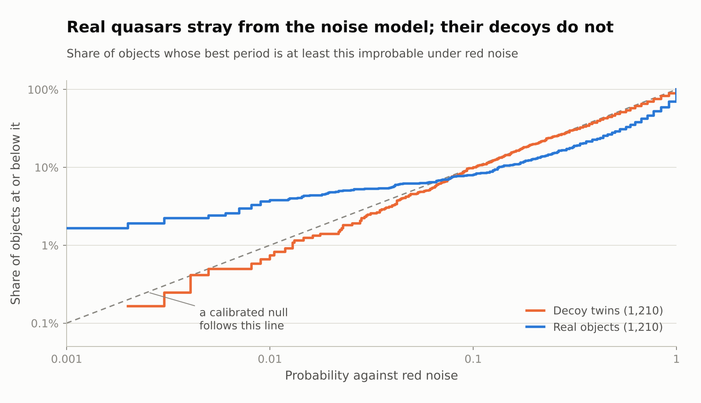
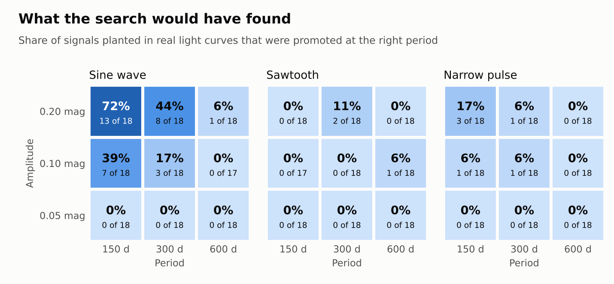

# First blind search: do any of 1,210 quasars vary with a strict period?

**Question.** Among Gaia DR3 quasar candidates brighter than G = 19 in one 215-square-degree patch of sky (HEALPix order 2, pixel 100, near RA 202°, Dec −10°), does any ZTF light curve hold a strictly periodic signal with a period between 40 days and a third of its length?

**Answer.** 1 of 1,210 objects searched was promoted to a vetted hit: a periodic component that red noise as modelled, the calendar and the sampling do not explain. A vetted hit is not yet a confirmed signal, and says nothing about cause. Of the 1,210 decoy twins, which contain nothing by construction, 0 were promoted, so about 0 false promotions are expected among the real objects. Of 484 signals planted in real light curves, 41 (8%) were promoted at the right period; the table below says which kinds.

**What the promoted object is.** A star, not a quasar. Gaia DR3 3613794004069753472 showed a clean 79.9-day cycle of about 0.3 magnitudes, in step in all three bands, over 33 cycles. Follow-up found a period of 0.49622 days in the unbinned ZTF measurements, and Gaia's own catalogue lists the source as an RR Lyrae star (type RRab) with a period of 0.49624 days. A half-day pulsation seen once a night beats at 80 days: the cycle the search found is that beat. Gaia's classifier had given the star a 96% chance of being a quasar. The dossier is [here](dossiers/gaia_3613794004069753472.md) and the follow-up is in [`follow_up/`](follow_up/).

**So the outcome is this.** In 1,210 quasar candidates the search found one object that is strictly periodic, and it is a known kind of pulsating star. No quasar in the sample shows a strict period that survives vetting. The pipeline found a real periodic signal blind, promoted nothing false, and learned something: an alias gate, which catches a fast variation showing up as a slow one, was missing. It has been added and fails this object.

## The sample

- Gaia DR3 quasar candidates in the sky cell: 1,426; after parallax and proper-motion cuts: 1,407; with a ZTF light curve: 1,288.
- After the fixed quality rules: 1,210 kept (39 for no usable band, 39 for too few nights dropped).
- Scatter of same-night pairs relative to the quoted error bars, pooled by band: g 0.76, i 0.99, r 1.12. Values below 1 mean the quoted errors are, if anything, too large; errors were never shrunk.
- Trial periods examined across all real objects: 381,598.

## Did the search behave?

<picture>
  <source media="(prefers-color-scheme: dark)" srcset="../../docs/figures/first-search-calibration-dark.png">
  
</picture>

| | Objects | At or below 0.05 | Expected | At or below 0.01 | Expected |
|---|---|---|---|---|---|
| Real objects | 1,210 | 75 | 60 | 46 | 12 |
| Decoy twins | 1,210 | 55 | 60 | 9 | 12 |

The population of real objects sets its own null: fitted centre -0.92 and width 1.61 on the z-score scale, where a perfectly modelled population gives 0 and 1. Probabilities were recalibrated with centre 0.00 and width 1.61, which can only make them less significant.

Share of decoy hits that each gate let through: bands 100%, calendar 100%, coherence 62%, holdout 27%, seasons 87%, window 98%.

Do real objects prefer particular periods more than their decoys do? Kolmogorov–Smirnov probability 7.4e-20 (a small value means they do, which points to instrumental periods or to trends the noise model lacks).

## The most significant real objects

| Object | Best period (days) | Probability | After recalibration | Gates failed | Promoted |
|---|---|---|---|---|---|
| gaia:3613794004069753472 | 79.9 | 3.2e-12 | 9.5e-06 | none | yes |
| gaia:3630864952883432064 | 428.8 | 7.2e-12 | 1.3e-05 | coherence | no |
| gaia:3629553823921510144 | 340.9 | 2.0e-07 | 0.0008 | window, holdout, coherence | no |
| gaia:3615884244394408960 | 884.6 | 6.0e-05 | 0.0084 | holdout, coherence | no |
| gaia:3619385570456033152 | 829.3 | 0.0002 | 0.01 | seasons, holdout, coherence | no |
| gaia:3616394628242930560 | 511.3 | 0.0002 | 0.01 | holdout, coherence | no |
| gaia:3621974752833502464 | 884.6 | 0.0003 | 0.02 | coherence | no |
| gaia:3604619614623791104 | 886.3 | 0.0003 | 0.02 | seasons, holdout, coherence | no |
| gaia:3631286168915689856 | 886.3 | 0.0003 | 0.02 | holdout, coherence | no |
| gaia:3604098991572142464 | 441.1 | 0.0010 | 0.03 | coherence | no |

Each of the five most significant, and every promoted object, has a dossier in `dossiers/`.

## What the search would have found

<picture>
  <source media="(prefers-color-scheme: dark)" srcset="../../docs/figures/first-search-completeness-dark.png">
  
</picture>

| Shape | Amplitude (mag) | Period (days) | Planted | Right period | Promoted | 95% interval | Share of quasars that could carry it unseen |
|---|---|---|---|---|---|---|---|
| sinusoid | 0.05 | 150 | 18 | 11 | 0 (0%) | 0%–18% | not constrained |
| sawtooth | 0.05 | 150 | 18 | 5 | 0 (0%) | 0%–18% | not constrained |
| flare | 0.05 | 150 | 18 | 8 | 0 (0%) | 0%–18% | not constrained |
| sinusoid | 0.05 | 300 | 18 | 7 | 0 (0%) | 0%–18% | not constrained |
| sawtooth | 0.05 | 300 | 18 | 4 | 0 (0%) | 0%–18% | not constrained |
| flare | 0.05 | 300 | 18 | 1 | 0 (0%) | 0%–18% | not constrained |
| sinusoid | 0.05 | 600 | 18 | 3 | 0 (0%) | 0%–18% | not constrained |
| sawtooth | 0.05 | 600 | 18 | 0 | 0 (0%) | 0%–18% | not constrained |
| flare | 0.05 | 600 | 18 | 0 | 0 (0%) | 0%–18% | not constrained |
| sinusoid | 0.10 | 150 | 18 | 18 | 7 (39%) | 20%–61% | below 1.2% |
| sawtooth | 0.10 | 150 | 17 | 17 | 0 (0%) | 0%–18% | not constrained |
| flare | 0.10 | 150 | 18 | 13 | 1 (6%) | 1%–26% | below 22.2% |
| sinusoid | 0.10 | 300 | 18 | 15 | 3 (17%) | 6%–39% | below 4.2% |
| sawtooth | 0.10 | 300 | 18 | 14 | 0 (0%) | 0%–18% | not constrained |
| flare | 0.10 | 300 | 18 | 7 | 1 (6%) | 1%–26% | below 22.2% |
| sinusoid | 0.10 | 600 | 17 | 8 | 0 (0%) | 0%–18% | not constrained |
| sawtooth | 0.10 | 600 | 18 | 3 | 1 (6%) | 1%–26% | below 22.2% |
| flare | 0.10 | 600 | 18 | 2 | 0 (0%) | 0%–18% | not constrained |
| sinusoid | 0.20 | 150 | 18 | 17 | 13 (72%) | 49%–88% | below 0.5% |
| sawtooth | 0.20 | 150 | 18 | 17 | 0 (0%) | 0%–18% | not constrained |
| flare | 0.20 | 150 | 18 | 18 | 3 (17%) | 6%–39% | below 4.2% |
| sinusoid | 0.20 | 300 | 18 | 15 | 8 (44%) | 25%–66% | below 1.0% |
| sawtooth | 0.20 | 300 | 18 | 14 | 2 (11%) | 3%–33% | below 7.7% |
| flare | 0.20 | 300 | 18 | 14 | 1 (6%) | 1%–26% | below 22.2% |
| sinusoid | 0.20 | 600 | 18 | 14 | 1 (6%) | 1%–26% | below 22.2% |
| sawtooth | 0.20 | 600 | 18 | 13 | 0 (0%) | 0%–18% | not constrained |
| flare | 0.20 | 600 | 18 | 6 | 0 (0%) | 0%–18% | not constrained |

The last column is an upper limit, at 95% confidence, on the fraction of quasars in this sample that carry such a signal, given that none was promoted. It uses the lower end of the recovery interval, so it errs on the side of a weaker limit. Where the recovery interval reaches zero, the search says nothing about that kind of signal. The limits are for quasars: the one object promoted is a star, so no quasar was promoted.

## What the real quasars taught

- **The noise model is too simple for a few percent of quasars.** Decoy twins, which are the model, follow the calibrated line exactly. Real objects do not: 46 have a probability at or below 0.01 where 12 are expected. Their best periods are not spread evenly. Fourteen sit between 829 and 886 days, at the long edge of the range, which is what slow trends beyond a damped random walk produce; another ten sit just outside the masked zones around the year and twice the year (340 to 341, 403 and 663 to 665 days), which is annual systematics leaking past a mask that was drawn too narrow.
- **The safeguards held.** The population recalibration widened the null by a factor of 1.61 to absorb the strays. Of the 46, 41 failed the hold-out gate, the warped-time gate or both; four passed the gates and fell short of the threshold after recalibration; the last is the star.
- **That widening is what limits the sensitivity.** After it, an object needs a raw probability near 3 in 10 million to be promoted. Sine waves of 0.2 magnitudes at 150 days are recovered 72% of the time; sawtooth and pulse shapes rarely. A noise model that fits slow trends, wider calendar masks, or a recalibration that depends on period would recover much of this. Any of them must be registered as a new search on a new sample, not applied to this one after the fact.
- **The second most significant object** (Gaia DR3 3630864952883432064, 429 days, six cycles) passed every gate but the warped-time test, which it missed narrowly (0.055 against a limit of 0.05). Six cycles cannot tell a clock from a wandering oscillation. It is not promoted. Its dossier is in `dossiers/`.
- **PG 1302−102**, the best-known periodic-quasar candidate, lies in this patch of sky and was searched like the rest: nothing (best period 111 days, probability 0.91). Its claimed 5.2-year cycle is longer than this search can test, because ZTF covers little more than one such cycle.

## What this does and does not mean

- The search covers strict periods from 40 days to a third of each light curve's length, away from the year and its fractions. Shorter periods, and periods near a year, are not tested.
- The noise model is one damped random walk per object. The comparison of real objects with their decoy twins above is the check on that model.
- A null result here is a statement about these objects, this period range and these amplitudes. It is not a statement that nothing periodic exists.
- Before this run, an engineering check on 47 quasars elsewhere in the sky found the lunar month in 60% of ZTF light curves. The search therefore starts at 40 days. That change, and two others, were made and disclosed before the run was registered.
- The candidate list is Gaia's, and it is not pure: the one strictly periodic object in it was a star.

## Record

- Run `quasar-ztf-gaia-pix2-100`, configuration hash `630f6b4980d15c009c5921b1eb9522723d6c33c0690f294e6667faab51f5ed06`.
- Hash of the hidden label table, committed before the analysis: `804478da3cc6d73dcc0b65fe606daf89e9abdec0c5f8561ee8edcd27f9d5c541`.
- Compute time: 27 minutes.
